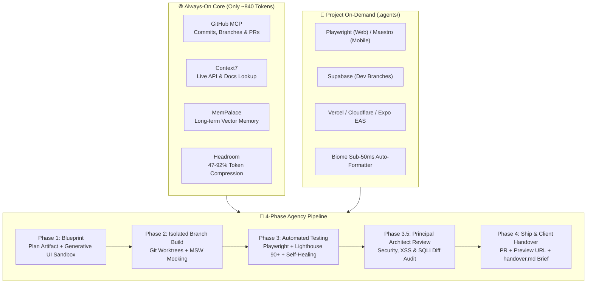

# 🏢 Universal Agency Pipeline

[](https://opensource.org/licenses/MIT)
[](https://modelcontextprotocol.io/)
[](#-multi-agent-compatibility)

The **Universal Agency Pipeline** is an enterprise-grade, token-efficient development system designed for autonomous software agencies and AI developers. 

Built on the open **Model Context Protocol (MCP)**, this stack works seamlessly across **Antigravity, Claude Code, Cursor, Windsurf, Claude Desktop, and VS Code (Cline / Roo Code)**. If you ever hit rate limits on one agent, you can switch immediately to another without breaking stride.

---

## 🚀 Architecture Overview



---

## ⚡ Quickstart (1 Command)

### Windows (PowerShell)
```powershell
git clone https://github.com/josuva777/universal-agency-pipeline.git
cd universal-agency-pipeline
.\setup.ps1
```

### macOS / Linux
```bash
git clone https://github.com/josuva777/universal-agency-pipeline.git
cd universal-agency-pipeline
chmod +x setup.sh && ./setup.sh
```

The script automatically:
1. Installs an isolated Python 3.13 runtime via `uv`
2. Installs `mempalace` (local memory) and `headroom-ai[mcp]` (token compressor)
3. Prompts for your GitHub Personal Access Token (stored safely in OS environment variables)
4. Copies and links the MCP configurations for **Antigravity, Cursor, Windsurf, Claude Desktop, and Claude Code**

---

## 🤖 Multi-Agent Compatibility

| AI Coding Agent | Config File Location | How It Connects |
| :--- | :--- | :--- |
| **Google Antigravity** | `~/.gemini/config/mcp_config.json` | Native global MCP + skill auto-loading |
| **Claude Desktop** | `%APPDATA%\Claude\claude_desktop_config.json` | Automatic stdio & Streamable HTTP support |
| **Cursor** | `~/.cursor/mcp.json` | Loads all 4 core tools into Cursor Composer |
| **Windsurf** | `~/.codeium/windsurf/mcp_config.json` | Native Windsurf Cascade MCP integration |
| **Claude Code CLI** | `~/.claude.json` | Terminal agent with full MCP access |
| **VS Code (Cline / Roo Code)** | `.vscode/mcp.json` | Full stdio connection |

---

## 🛡️ The Token Guardrail (Why It Stays Fast)
Most developers overload their AI with 15 active MCP servers, wasting 8,000+ tokens on every single message before typing a word.

This repository enforces strict **2-Tier Architecture**:
1. **Always-On Core (~840 tokens)**: GitHub + Context7 + MemPalace + Headroom.
2. **Project-Only (`.agents/`)**: Playwright, Supabase, Vercel, and Cloudflare load **only** inside projects that use them.
3. **Pre-Deploy Security**: Security pentests (Strix) and AI evaluations (Promptfoo) run strictly as **one-shot CLI commands**, never bloating persistent chat context.

---

## 📁 Repository Structure

```
universal-agency-pipeline/
├── .agents/                        # Universal workspace template for client projects
│   ├── mcp_config.json             # Web MCPs (Playwright, Supabase, Vercel, Cloudflare)
│   ├── mcp_config.mobile.json      # Mobile MCPs (Maestro, Supabase)
│   ├── hooks.json                  # Sub-50ms Biome formatting hook
│   └── AGENTS.md                   # Project-level rules & zero-leak guardrails
├── configs/                        # Ready-to-use configs for every AI agent
│   ├── antigravity/mcp_config.json
│   ├── claude-desktop/claude_desktop_config.json
│   ├── cursor/mcp.json
│   ├── windsurf/mcp_config.json
│   └── claude-code/mcp_config.json
├── skills/                         # Reusable agent skills
│   ├── agency-pipeline/SKILL.md    # 4-Phase feature workflow
│   ├── agency-scaffold/SKILL.md    # "scaffold workspace" generator
│   └── pre-deploy-security/SKILL.md# Strix & Promptfoo CLI runner
├── templates/
│   ├── handover-template.md        # Client delivery brief
│   ├── CHANGELOG.md                # KeepAChangelog starter
│   └── .gitignore                  # Zero-leak secret filter
├── setup.ps1                       # Windows installer
├── setup.sh                        # macOS / Linux installer
├── AGENTS.md                       # Master rules file for AI agents
└── README.md
```

---

## 💼 How to Scaffold a Client Project
Inside any new or existing project folder, run:
```bash
# In your AI chat box:
scaffold workspace
```
Or manually copy the `.agents/` folder into your project root:
```bash
cp -r /path/to/universal-agency-pipeline/.agents ./your-project/
```

---

## 📄 License
MIT License. Free to use for personal, commercial, and agency projects.
