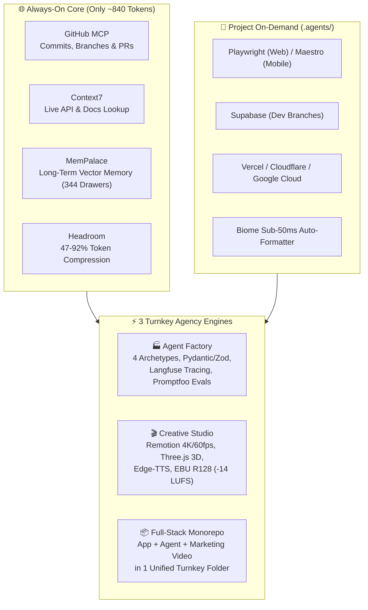

# 🏢 Universal Agency Pipeline

[](https://opensource.org/licenses/MIT)
[](https://modelcontextprotocol.io/)
[](#-multi-agent-compatibility)

The **Universal Agency Pipeline** is an enterprise-grade, token-efficient autonomous development system. It transforms any AI coding assistant into a full-service software agency capable of building:
1. 🌐 **Full-Stack Web & Mobile Apps** (Next.js, Supabase, Tailwind, Stripe)
2. 🤖 **Production-Grade AI Agents** (Hybrid RAG, LangGraph State Machines, ReAct Loops, Streaming Copilots)
3. 🎬 **Broadcast-Quality 4K Commercials & Media** (Remotion, Three.js 3D mockups, GSAP kinetic text, Microsoft Neural voiceover)

Built on the open **Model Context Protocol (MCP)**, this stack works seamlessly across **Antigravity, Claude Desktop, Claude Code, Cursor, Windsurf, and VS Code (Cline / Roo Code)**.

---

## 🚀 Architecture Overview



---

## ⚡ 1-Sentence Natural Language Triggers

Whenever you open a new folder in VS Code, simply use these natural language phrases:

| Service Wanted | What to Say in Chat | What Happens Automatically |
| :--- | :--- | :--- |
| **New Web/Mobile App** | `scaffold workspace` | Configures isolated dev MCPs, sub-50ms Biome auto-formatting, and tests. |
| **Build Any AI Agent** | `create agent for [description]` | Scans PC hardware, classifies archetype (RAG/Workflow/Action/Copilot), generates `AGENT_SPEC.md`, Pydantic/Zod schemas, and Langfuse tracing. |
| **Render 4K Video & Brand** | `create video for [brief]` | Generates Microsoft Neural voiceover, 4K Remotion commercial, Three.js 3D mockup, SVG logo, and HTML Brand Portal. |
| **All-in-One Product Launch** | `build full app for [description]` | Builds the Next.js full-stack app, embeds the streaming agent in `/api/chat`, and puts both marketing & demo videos in `creative/`! |

---

## 📦 3-in-1 Turnkey Monorepo Architecture

When clients order an AI product, never build disconnected pieces in separate folders. Deliver a unified monorepo:

```
client-turnkey-project/
├── app/                        # 1. THE WEB APP & CHATBOT
│   ├── page.tsx                # High-converting Landing Page
│   ├── chat/page.tsx           # Real-time Streaming AI Chat UI
│   └── api/chat/route.ts       # 🤖 Streaming Agent Backend (Vercel AI SDK)
│
├── creative/                   # 2 & 3. BOTH VIDEOS & BRANDING
│   ├── commercial_promo.mp4    # 🎬 Video 1: 4K Commercial Ad (for social media)
│   ├── demo_how_to_use.mp4     # 📱 Video 2: "How to Use" Onboarding Walkthrough
│   ├── logo_master.svg         # Official vector brand logo
│   └── brand_kit.html          # Interactive Client Portal (swatches, audio, download links)
│
├── AGENT_SPEC.md               # Strict circuit breakers (max 8 steps) & schemas
└── README.md                   # Client handover instructions
```

---

## 🛡️ Zero-Freeze Hardware Scanner (`system_scanner.py`)
To prevent heavy AI models from freezing laptops with 8GB RAM, our built-in hardware scanner audits your CPU, RAM, and GPU:
- **Tier 1 (Light / $\le$ 12GB RAM, iGPU)**: Automatically restricts local models to lightweight 1B–3B weights (Llama-3.2-1B, Qwen2.5-Coder-1.5B, Kokoro 82M) and routes heavy reasoning to **Google Gemini Cloud APIs (0 MB local storage used)**.
- **Tier 2 (Mid / 16–24GB RAM, 6–8GB VRAM)**: Enables 7B–8B quantized models (Q4_K_M).
- **Tier 3 (Heavy / $\ge$ 32GB RAM, 12GB+ VRAM)**: Enables 14B–32B local inference.

---

## ☁️ Zero-Bloat Cloud Storage: Google Drive 5TB & Google Cloud
- **5 TB Google Drive (`G:\My Drive\Agency Deliverables`)**: All rendered 4K commercial videos, audio masters, and brand portals automatically sync to your Google Drive. Zero C: drive space consumed!
- **Google Cloud Storage (`gcs_uploader.py`)**: Direct bucket upload with public streaming URLs.
- **MemPalace Long-Term Memory**: All uploaded asset URLs are permanently remembered in local vector drawers (344 drawers active) so you can ask for them anytime in any session.

---

## 🤖 Multi-Agent Compatibility

| AI Coding Agent | Config File Location | How It Connects |
| :--- | :--- | :--- |
| **Google Antigravity** | `~/.gemini/config/mcp_config.json` | Native global MCP + skill auto-loading |
| **Claude Desktop** | `%APPDATA%\Claude\claude_desktop_config.json` | Automatic stdio & Streamable HTTP support |
| **Cursor** | `~/.cursor/mcp.json` | Loads all core tools into Cursor Composer |
| **Windsurf** | `~/.codeium/windsurf/mcp_config.json` | Native Windsurf Cascade MCP integration |
| **Claude Code CLI** | `~/.claude.json` | Terminal agent with full MCP access |
| **VS Code (Cline / Roo Code)** | `.vscode/mcp.json` | Full stdio connection |

---

## 📁 Repository Structure

```
universal-agency-pipeline/
├── .agents/                        # Universal workspace template for client projects
│   ├── mcp_config.json             # Web MCPs (Playwright, Supabase, Vercel, Cloudflare)
│   ├── mcp_config.mobile.json      # Mobile MCPs (Maestro, Supabase)
│   ├── hooks.json                  # Sub-50ms Biome auto-formatting hook
│   └── AGENTS.md                   # Enterprise zero-leak guardrails
├── configs/                        # Ready-to-use configs for every AI agent
│   ├── antigravity/mcp_config.json
│   ├── claude-desktop/claude_desktop_config.json
│   ├── cursor/mcp.json
│   ├── windsurf/mcp_config.json
│   └── claude-code/mcp_config.json
├── skills/                         # Reusable agent skills
│   ├── agency-pipeline/SKILL.md    # 4-Phase feature workflow
│   ├── agency-scaffold/SKILL.md    # "scaffold workspace" generator
│   ├── agent-builder/              # Universal AI Agent Factory & Scaffolder
│   │   ├── system_scanner.py       # Hardware safety auditor
│   │   ├── scaffold_agent.py       # 1-command agent generator
│   │   └── references/             # RAG, Workflow, ReAct, Copilot cards
│   ├── creative-studio/            # Broadcast Commercial & Brand Studio
│   │   └── references/             # Shaders, 3D rigs, EBU R128 mastering
│   └── pre-deploy-security/        # Strix & Promptfoo CLI runner
├── templates/                      # Full Project Starters
│   ├── fullstack-agent-app/        # Turnkey Monorepo: App + Agent + Creative
│   ├── creative-agent-studio/      # Complete Remotion Video & Audio Engine
│   │   ├── start_studio.bat        # 1-Click Desktop Launcher
│   │   ├── studio.ps1              # Interactive Terminal Dashboard
│   │   └── agents/                 # Orchestrator, SFX, Logo, GCS, R2
│   ├── handover-template.md        # Client delivery brief
│   └── CHANGELOG.md                # KeepAChangelog template
├── setup.ps1                       # Windows 1-click installer
├── setup.sh                        # macOS / Linux 1-click installer
├── .gitignore                      # Zero-leak secret filter
├── AGENTS.md                       # Master rules file for AI agents
└── README.md                       # Master Documentation
```

---

## 🔒 Zero-Leak Security Discipline
- **NEVER** stages `.env`, `.env.local`, API tokens, or credentials.
- Multi-layer `.gitignore` protects credentials, model weights, and media temp files.
- Automated secret-scanning audit before commits.

---

## 📄 License
MIT License. Free to use for personal, commercial, and client agency projects.
