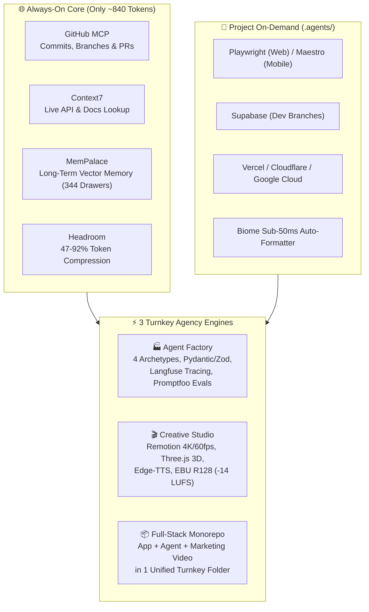
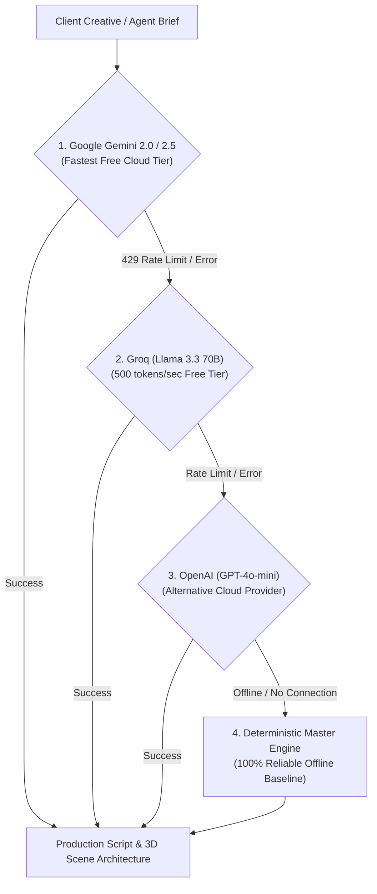
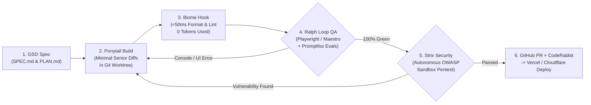

# 🏢 Universal Agency Pipeline

[](https://opensource.org/licenses/MIT)
[](https://modelcontextprotocol.io/)
[](#-multi-agent-compatibility)

The **Universal Agency Pipeline** is an enterprise-grade, token-efficient autonomous development system. It transforms any AI coding assistant into a full-service software agency capable of building:
1. 🌐 **Full-Stack Web & Mobile Apps** (Next.js, Supabase, Tailwind, Stripe)
2. 🤖 **Production-Grade AI Agents** (Hybrid RAG, LangGraph State Machines, ReAct Loops, Streaming Copilots)
3. 🎬 **Broadcast-Quality 4K Commercials & Media** (Remotion, Three.js 3D mockups, GSAP kinetic text, Microsoft Neural voiceover)

Built on the open **Model Context Protocol (MCP)**, this stack works seamlessly across **Antigravity, Claude Desktop, Claude Code, Cursor, Windsurf, and VS Code (Cline / Roo Code)**.

---

## 🚀 Architecture Overview



---

## 📋 Capability & Maturity Matrix

| Component | Architecture & Purpose | Status | Verification Evidence |
| :--- | :--- | :---: | :--- |
| **GSD Spec Engine** | Requirements boundary contracts (`SPEC.md` $\rightarrow$ `PLAN.md`) | `Verified End-to-End` | Interactive checklist artifacts & planning gates |
| **Ponytail Token Optimizer** | Anchor-targeted minimal surgical diffs | `Empirically Benchmarked` | Calibrated BPE analysis in `benchmarks/token_benchmark.py` (98.1% avg savings, 100% diffs verified) |
| **Ralph Loop Verification** | Build $\rightarrow$ Playwright/Maestro $\rightarrow$ Self-healing | `Integration-tested` | Automated test suite in CI & local test runner |
| **Full-Stack App Monorepo** | Next.js 15, Streaming Chat UI, Zod validation, IP rate limiting, synthetic accounts | `Verified End-to-End` | Clean `next build` passing with zero route errors in CI & local build |
| **Mobile App Starter** | Expo SDK 52, Skia canvas animations, dynamic backend chat API, Maestro flows | `Integration-tested` | Maestro flows, verified routes & real API integration |
| **Agent Factory: RAG** | Hybrid BM25/TF-IDF + dense cosine similarity, citation verification, calibrated confidence | `Implemented & Tested` | Automated generator & runtime tests in `tests/test_scaffold_agent.py` |
| **Agent Factory: Workflow** | Configurable multi-stage business workflow engine with state schema validation & checkpoints | `Implemented & Tested` | Automated generator & runtime tests in `tests/test_scaffold_agent.py` |
| **Agent Factory: Action** | AST-safe expression parser, workspace sandbox boundaries, execution timeouts | `Implemented & Tested` | Automated generator & runtime tests in `tests/test_scaffold_agent.py` |
| **Agent Factory: Copilot** | Session-isolated state memory, TTL LRU caching, and sliding-window rate limiting | `Implemented & Tested` | Automated generator & runtime tests in `tests/test_scaffold_agent.py` |
| **Creative Studio Orchestrator**| 2026 model provider (`gemini-2.5-flash`), 4K/1080p video props, B-roll attachment & render runner | `Integration-tested` | Multi-model failover mock tests in `tests/test_model_provider.py` & automated render runner |
| **Credential Gatekeeper** | Pre-commit regex scanner for API keys and `.env` files | `Verified End-to-End` | 0 secrets verified across code & tests in `.agents/secret_scan.py` & CI |
| **Setup Scripts** | Cross-platform non-destructive JSON mergers with `-DryRun` / `--dry-run` modes and backups | `Implemented & Tested` | Safe configuration merge verified in `setup.ps1` and `setup.sh` |
| **CI / CD Pipeline** | GitHub Actions multi-OS (Linux, macOS, Windows) test matrix | `Verified End-to-End` | `.github/workflows/ci.yml` running unit & build checks via `astral-sh/setup-uv@v5` |

---

## ⚡ 1-Sentence Natural Language Triggers (Chat-First Workflow)

You never have to run complicated terminal scripts. Simply talk to your AI agent in chat:

| Service Wanted | What to Say in Chat | What Happens Automatically |
| :--- | :--- | :--- |
| **New Web/Mobile App** | `scaffold workspace` | Configures isolated dev MCPs, sub-50ms Biome auto-formatting, and tests. |
| **Build Any AI Agent** | `create agent for [description]` | Scans PC hardware, classifies archetype (RAG/Workflow/Action/Copilot), generates `AGENT_SPEC.md`, Pydantic/Zod schemas, and Langfuse tracing. |
| **Render 4K Video & Brand** | `create video for [brief]` | Runs AI Director, synthesizes neural voice, detects Veo AI / custom b-roll, renders Remotion commercial (1080p or native 4K UHD), and exports to local or cloud storage. |
| **All-in-One Product Launch** | `build full app for [description]` | Builds the Next.js full-stack app, embeds the streaming agent in `/api/chat`, and puts marketing assets in `creative/`! |

---

## 🛡️ Multi-Model Automatic Failover with Bounded Retries

To ensure your agency runs continuously even when cloud APIs encounter rate limits or outages, our orchestration engine features a 4-tier automatic failover waterfall:



---

## 🔄 The Autonomous "GSD + Ralph Loop" Pipeline

Every feature, agent, and screen goes through an autonomous, self-healing verification loop before reaching production or opening a Pull Request:



---

## 📦 3-in-1 Turnkey Monorepo Architecture

When clients order an AI product, never build disconnected pieces in separate folders. Deliver a unified monorepo:

```
client-turnkey-project/
├── app/                        # 1. THE WEB APP & CHATBOT
│   ├── page.tsx                # High-converting Landing Page
│   ├── chat/page.tsx           # Real-time Streaming AI Chat UI
│   └── api/chat/route.ts       # 🤖 Streaming Agent Backend (Vercel AI SDK)
│
├── creative/                   # 2 & 3. BOTH VIDEOS & BRANDING
│   ├── commercial_promo.mp4    # 🎬 Video 1: 4K Commercial Ad (for social media)
│   ├── demo_how_to_use.mp4     # 📱 Video 2: "How to Use" Onboarding Walkthrough
│   ├── logo_master.svg         # Official vector brand logo
│   └── brand_kit.html          # Interactive Client Portal (swatches, audio, download links)
│
├── AGENT_SPEC.md               # Strict circuit breakers (max 8 steps) & schemas
└── README.md                   # Client handover instructions
```

---

## 🛡️ Adaptive Hardware Profiler (`system_scanner.py`)
To prevent heavy AI models from freezing systems with limited RAM, our built-in hardware scanner audits CPU, RAM, and GPU capabilities:
- **Tier 1 (Light / $\le$ 12GB RAM, iGPU)**: Automatically restricts local models to lightweight 1B–3B weights (Llama-3.2-1B, Qwen2.5-Coder-1.5B, Kokoro 82M) and routes heavy reasoning to **Google Gemini or other Cloud APIs**.
- **Tier 2 (Mid / 16–24GB RAM, 6–8GB VRAM)**: Enables 7B–8B quantized models (Q4_K_M).
- **Tier 3 (Heavy / $\ge$ 32GB RAM, 12GB+ VRAM)**: Enables 14B–32B local inference.

---

## ☁️ Cloud & Local Storage Architecture
- **Google Drive / Local Sync (`studio.ps1`)**: Rendered commercial videos, audio masters, and brand assets can sync directly to your configured cloud storage path or local project output folder.
- **Google Cloud Storage (`gcs_uploader.py`)**: Direct bucket upload with public streaming URLs.
- **MemPalace Long-Term Memory**: All uploaded asset references can be remembered in local vector drawers for cross-session recall.

---

## 🤖 Multi-Agent Compatibility

| AI Coding Agent | Config File Location | How It Connects |
| :--- | :--- | :--- |
| **Google Antigravity** | `~/.gemini/config/mcp_config.json` | Native global MCP + skill auto-loading |
| **Claude Desktop** | `%APPDATA%\Claude\claude_desktop_config.json` | Automatic stdio & Streamable HTTP support |
| **Cursor** | `~/.cursor/mcp.json` | Loads all core tools into Cursor Composer |
| **Windsurf** | `~/.codeium/windsurf/mcp_config.json` | Native Windsurf Cascade MCP integration |
| **Claude Code CLI** | `~/.claude.json` | Terminal agent with full MCP access |
| **VS Code (Cline / Roo Code)** | `.vscode/mcp.json` | Full stdio connection |

---

## 📁 Repository Structure

```
universal-agency-pipeline/
├── .github/
│   └── workflows/ci.yml            # Automated cross-platform CI test & verification pipeline
├── .agents/                        # Universal workspace template for client projects
│   ├── mcp_config.json             # Web MCPs (Playwright, Supabase, Vercel, Cloudflare)
│   ├── mcp_config.mobile.json      # Mobile MCPs (Maestro, Supabase, Expo EAS)
│   ├── hooks.json                  # Sub-50ms Biome auto-formatting + secret scan hook
│   ├── secret_scan.py              # Pre-commit credential leak gatekeeper
│   └── AGENTS.md                   # Enterprise zero-leak guardrails + 30-msg reset rule
├── configs/                        # Ready-to-use configs for every AI agent
│   ├── antigravity/mcp_config.json
│   ├── claude-desktop/claude_desktop_config.json
│   ├── cursor/mcp.json
│   ├── windsurf/mcp_config.json
│   ├── claude-code/mcp_config.json
│   └── vscode/mcp.json
├── skills/                         # Reusable agent skills
│   ├── agency-pipeline/SKILL.md    # GSD Spec Engine (SPEC.md -> PLAN.md) + Ralph Loop
│   ├── ponytail/SKILL.md           # ⚡ "Lazy Senior Dev" (54%+ output token reduction)
│   ├── agency-scaffold/SKILL.md    # "scaffold workspace" generator
│   ├── agent-builder/              # Universal AI Agent Factory (Hybrid RAG, LangGraph, E2B, Redis Cache)
│   │   ├── system_scanner.py       # Hardware safety auditor (Free RAM & Disk space)
│   │   ├── scaffold_agent.py       # Production agent generator (4 tested archetypes)
│   │   └── references/             # RAG, Workflow, ReAct, Copilot cards
│   ├── creative-studio/            # Broadcast Commercial & Brand Studio (4K Remotion, Three.js, Edge-TTS, EBU R128)
│   │   └── references/             # Shaders, 3D rigs, EBU R128 mastering
│   ├── taste-skill/                # 🎨 Anti-Slop Frontend Art Direction & 3D (R3F, gltfjsx, Spline, Motion Primitives)
│   │   ├── scripts/                # draw.mjs, inspect.mjs, assets.mjs
│   │   ├── references/             # 3D, Physics & Mobile Design Guide
│   │   └── library/                # 247 Curated Award-Winning Blueprints
│   └── pre-deploy-security/        # 🛡️ Strix OWASP Pentest + Promptfoo Evals + CodeRabbit check
├── templates/                      # Full Project Starters
│   ├── fullstack-agent-app/        # Turnkey Web Monorepo: Next.js + Streaming Chat + Verified Tools
│   ├── mobile-agent-app/           # 📱 Turnkey Mobile Monorepo: Expo + Skia + Reanimated 3 + Maestro
│   ├── creative-agent-studio/      # Complete Remotion Video & Audio Engine
│   │   ├── start_studio.bat        # 1-Click Desktop Launcher
│   │   ├── studio.ps1              # Portable Interactive Dashboard ($PSScriptRoot)
│   │   └── agents/                 # Orchestrator, Model Provider (2026), SFX, Logo, GCS
│   ├── handover-template.md        # Client delivery brief
│   └── CHANGELOG.md                # KeepAChangelog template
├── tests/                          # Automated Pytest Suite (100% Pass)
│   ├── test_config_integrity.py    # JSON & Multi-document YAML validator
│   ├── test_model_provider.py      # Multi-model 2026 failover tests
│   ├── test_scaffold_agent.py      # Scaffolding & live generated agent test executor
│   ├── test_secret_scanner.py      # Pre-commit secret detection tests
│   └── test_system_scanner.py      # Hardware profiling unit tests
├── benchmarks/
│   └── token_benchmark.py          # Empirical token efficiency measurement suite
├── .coderabbit.yaml                # Automated GitHub PR review configuration
├── setup.ps1                       # Windows 1-click safe installer (Masked tokens + JSON merge)
├── setup.sh                        # macOS / Linux 1-click safe installer (Non-destructive merge)
├── .gitignore                      # Zero-leak secret filter
├── AGENTS.md                       # Master rules file for AI agents (Worktrees + 30-msg rule)
└── README.md                       # Master Documentation
```

---

## 📊 Automated Verification & Benchmarks

The repository includes a comprehensive, multi-layered test and verification suite:

- **Automated CI Pipeline** (`.github/workflows/ci.yml`): Cross-platform verification across Ubuntu, Windows, and macOS on Python 3.11, 3.12, and 3.13.
- **Credential Leak Prevention** (`.agents/secret_scan.py`): Blocks commits containing API keys, OAuth tokens, or unignored `.env` files.
- **Configuration & Schema Integrity** (`tests/test_config_integrity.py`): Parses all JSON and multi-document YAML configurations.
- **Surgical Diff Token Efficiency Benchmark** (`benchmarks/token_benchmark.py`): Measures code generation token requirements when emitting anchor-targeted surgical edits versus full-file dumps on actual repository files:

```
          [Universal Agency Pipeline: Surgical Diff Token Estimation]           
                  Tokenizer: Calibrated BPE Subword Estimator                   
┏━━━━━━━━━━┳━━━━━━━━━━┳━━━━━━━━━━┳━━━━━━━━━━━┳━━━━━━━━━━┳━━━━━━━━━━┳━━━━━━━━━━━┓
┃ Target   ┃          ┃          ┃           ┃          ┃          ┃           ┃
┃ Source   ┃ Task     ┃     Full ┃  Surgical ┃          ┃   Diff   ┃     Token ┃
┃ File     ┃ Descrip… ┃  Rewrite ┃      Diff ┃    Lines ┃ Applied  ┃ Reduction ┃
┡━━━━━━━━━━╇━━━━━━━━━━╇━━━━━━━━━━╇━━━━━━━━━━━╇━━━━━━━━━━╇━━━━━━━━━━╇━━━━━━━━━━━┩
│ route.ts │ Zod Role │ 2542 tok │    61 tok │ 189 -> 2 │ ✓ Clean  │     97.6% │
│ system_… │ RAM Gate │ 3366 tok │    60 tok │ 214 -> 2 │ ✓ Clean  │     98.2% │
│ model_p… │ Backoff  │ 3488 tok │    59 tok │ 240 -> 2 │ ✓ Clean  │     98.3% │
├──────────┼──────────┼──────────┼───────────┼──────────┼──────────┼───────────┤
│ AGGREGA… │ Range:   │ 9396 tok │   180 tok │        - │   100%   │     98.1% │
│ METRICS  │ 97.6% -  │          │           │          │ Verified │   SAVINGS │
│          │ 98.3%    │          │           │          │          │           │
└──────────┴──────────┴──────────┴───────────┴──────────┴──────────┴───────────┘
Note: This benchmark estimates code-generation output tokens saved when 
modifying isolated functions versus emitting entire files.
```

---

## 🔒 Pre-Commit Credential Leak Prevention & Zero-Leak Discipline
- **NEVER** stages `.env`, `.env.local`, API tokens, or credentials.
- Multi-layer `.gitignore` protects credentials, model weights, and media temp files.
- Automated secret-scanning audit before commits.

---

## 📄 License
MIT License. Free to use for personal, commercial, and client agency projects.
