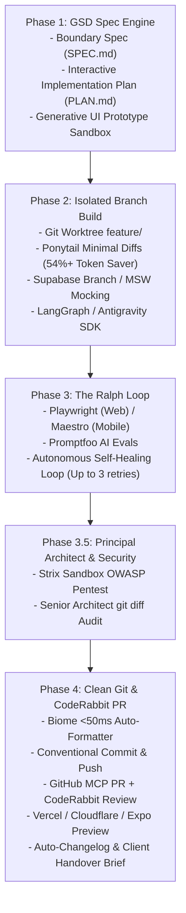

# The Ultimate Agency Pipeline

This skill guides you through building client-ready features with enterprise-grade quality control, security, performance audits, and polished client delivery.

---

## Phase 1 — GSD Spec Engine & Architecture

1. **Requirements & Boundary Ingestion (`SPEC.md`)**:
   - Parse client request, defining exact user stories, data schemas, API contracts, and explicit constraints.
2. **Generative UI Prototype (Sandbox)**:
   - For user-facing features, generate an interactive HTML/Tailwind sandbox prototype in an artifact viewer before writing production code.
   - Allows instant visual feedback and alignment on layout and interactions.
3. **Interactive Implementation Plan (`PLAN.md`)**:
   - Generate an Implementation Plan artifact with:
     - Clickable task checklist
     - Mermaid architecture / flow diagram
     - File-by-file changes and diffs
     - Testing & verification criteria
4. **Approval Gate**:
   - **DO NOT write production code until the user approves the plan.**

---

## Phase 2 — Isolated Branch Build (Git Worktree & Ponytail Diffs)

1. **Isolated Worktree / Branch**:
   - Create a dedicated Git worktree: `git worktree add ../feature-<slug> -b feature/<slug>`.
   - Main branch remains 100% untouched until testing and PR review.
2. **Ponytail Senior Diffs**:
   - Apply minimal surgical diffs via `replace_file_content`.
   - Never dump entire files when making small updates (cuts token cost by 54%+).
3. **Backend & API Mocking**:
   - **Supabase**: If database schema changes are needed, spin up an isolated Supabase Preview Branch.
   - **Offline / Zero-Cost Mocking**: If third-party APIs (Stripe, Twilio, OpenAI) have rate limits or lack client credentials, create Mock Service Worker (MSW) handlers so development is never blocked.
4. **Code Implementation**:
   - Frontend/3D: Motion Primitives, React Three Fiber, `gltfjsx`, Spline, Tailwind CSS, Skia (mobile).
   - Agentic AI: `LangGraph` or `Antigravity SDK` patterns with typed Pydantic/Zod schemas.
5. **Rapid Formatting & Linting**:
   - Format with **Biome** (`npx @biomejs/biome check --write .`) in milliseconds.

---

## Phase 3 — The Ralph Loop (Automated Self-Healing Audits)

1. **Automated E2E Testing**:
   - **Web**: Playwright headless Chrome (clicks interactive UI, catches uncaught exceptions & console errors, records video proof).
   - **Mobile**: Maestro flow runner (`maestro test .maestro/flows/chat.yaml`).
2. **AI Evals**: Run Promptfoo adversarial red-teaming cases.
3. **The Ralph Self-Healing Loop**:
   - If tests fail, uncaught exceptions occur, or Lighthouse scores fall below target:
     - The agent autonomously inspects the error trace.
     - Diagnoses the root cause and applies a targeted fix.
     - Automatically re-runs the test suite (up to 3 autonomous self-healing retries).
     - Only escalates to the user if blocked after 3 iterations.
4. **Lighthouse Core Web Vitals Audit**:
   - Target: **Performance 90+**, **Accessibility (a11y) 95+**, **Best Practices 95+**, **SEO 90+**.

---

## Phase 3.5 — Principal Architect & Security Review

1. **Strix OWASP Sandbox Pentest**:
   - Run autonomous CLI pentest via `pre-deploy-security` to verify zero injection vulnerabilities, auth bypasses, or data exposure.
2. **Senior Architect Review**:
   - Spawn a code-review subagent with persona: *"Senior Staff Security & Performance Architect"*.
   - **Inspects**: The complete `git diff origin/main...HEAD`.
   - **Verification Checklist**:
     - [ ] No unhandled async errors or missing error boundaries
     - [ ] No SQL injection, XSS vulnerabilities, or secret leaks (`.env`, API tokens)
     - [ ] React hooks dependencies correctly mapped (no memory leaks or infinite re-renders)
     - [ ] Responsive design verified on mobile viewports

---

## Phase 4 — Clean Git, CodeRabbit PR & Client Handover

1. **Secret Leak Verification**:
   - Automated scan verifying no tokens, credentials, or `.env` files are staged.
2. **Clean Conventional Commits**:
   - Stage and commit with standard prefixes: `feat:`, `fix:`, `perf:`, `chore:`, `docs:`.
3. **GitHub Pull Request + CodeRabbit Review**:
   - Push branch to remote.
   - Open Pull Request via GitHub MCP with automated **CodeRabbit** AI code review (`.coderabbit.yaml`).
   - Attach test recordings, screenshots, and Lighthouse score badges.
4. **Staging Preview Deployment**:
   - **Vercel / Cloudflare**: Generate client preview URL.
   - **Expo EAS**: Generate QR preview build for mobile.
5. **Auto-Changelog (KeepAChangelog)**:
   - Update `CHANGELOG.md` under `[Unreleased]` with *Added*, *Changed*, *Fixed*.
6. **Client Delivery Brief (`handover.md`)**:
   - Automatically generate a beautiful client-facing handover document with preview link, feature guide, and summary ready to forward directly to the client.
7. **MemPalace Architecture Checkpoint**:
   - Save high-signal architecture decisions (ADR) into MemPalace so future turns and sessions retain project context verbatim.
