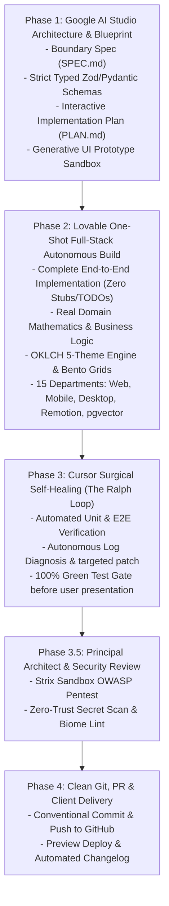

# The Ultimate Agency Pipeline — Autonomous Super-Agent Engine

This skill guides the Antigravity agent to operate with the combined power of **Lovable (one-shot full-stack autonomy)**, **Google AI Studio (deep prompt precision & typed schemas)**, and **Cursor (deep repository awareness & surgical self-healing)**.

---

## Phase 1 — Google AI Studio Architecture & Blueprint

1. **Requirements & Domain Taxonomy (`SPEC.md`)**:
   - Ingest user concept; classify sector (SaaS, FinTech, Industrial, Health, Creative Video, DevSecOps).
   - Formulate strict compile-time Zod (TypeScript) or Pydantic (Python) schemas for all data models and API contracts.
2. **Generative UI Prototype (Sandbox)**:
   - For visual interfaces, synthesize an interactive prototype sandbox with real interactive state before generating production packages.
3. **Interactive Implementation Plan (`PLAN.md`)**:
   - Generate an Implementation Plan artifact with clickable task checklist, Mermaid architecture diagrams, file-by-file changes, and testing criteria.
4. **Approval Gate**:
   - Review and align with the user before isolated branch build.

---

## Phase 2 — Lovable One-Shot Full-Stack Autonomous Build

1. **End-to-End Complete Execution**:
   - **Zero Placeholders**: Never leave `// TODO: implement later` or placeholder copy. Write complete, working implementations for every file, component, route, and database migration.
   - **Real Mathematics & Logic**: Implement real algorithms (mortgage amortizations, CNC toolpaths, cryptographic hash chaining, orderbook matching), never fake random numbers.
2. **Anti-Slop Visual Craft**:
   - Enforce 5 dynamic OKLCH palettes (`Cyberpunk Matrix`, `Oceanic Cobalt`, `Avionics Amber`, `Swiss Bauhaus`, `Lockdown Crimson`) with zero color mismatches.
   - Apply razor-sharp 1px glass borders (`rgba(255, 255, 255, 0.08)`), mouse-following spotlights, and Emil Kowalski spring animations (`stiffness: 400, damping: 30`).
3. **15-Department Scalability**:
   - Capable of delivering full-stack Next.js 15 Web, 120Hz Expo SDK 52 Native Mobile, ~600KB Tauri 2.0 Rust Desktop, Hollywood Remotion v4 Video Studios, pgvector Hybrid RAG, and WebGPU on-device offline AI.
4. **Ponytail Minimal Diffs**:
   - When modifying existing files, apply senior-dev surgical diffs via `replace_file_content` to keep context window fresh.

---

## Phase 3 — Cursor Surgical Self-Healing (The Ralph Loop)

1. **Automated Verification**:
   - Run automated test suites (pytest for Python, vitest/jest for TypeScript, Playwright for Web).
   - Verify link integrity and JavaScript syntax across all pages.
2. **Autonomous Self-Healing Loop**:
   - If a build fails or tests fail:
     - Autonomously read the error stack trace.
     - Diagnose the root cause and apply a targeted surgical patch.
     - Re-test immediately (up to 3 automated iterations).
     - Never ask the user to fix an error the agent can heal autonomously.
4. **Lighthouse Core Web Vitals Audit**:
   - Target: **Performance 90+**, **Accessibility (a11y) 95+**, **Best Practices 95+**, **SEO 90+**.

---

## Phase 3.5 — Principal Architect & Security Review

1. **Strix OWASP Sandbox Pentest**:
   - Run autonomous CLI pentest via `pre-deploy-security` to verify zero injection vulnerabilities, auth bypasses, or data exposure.
2. **Senior Architect Review**:
   - Spawn a code-review subagent with persona: *"Senior Staff Security & Performance Architect"*.
   - **Inspects**: The complete `git diff origin/main...HEAD`.
   - **Verification Checklist**:
     - [ ] No unhandled async errors or missing error boundaries
     - [ ] No SQL injection, XSS vulnerabilities, or secret leaks (`.env`, API tokens)
     - [ ] React hooks dependencies correctly mapped (no memory leaks or infinite re-renders)
     - [ ] Responsive design verified on mobile viewports

---

## Phase 4 — Clean Git, CodeRabbit PR & Client Handover

1. **Secret Leak Verification**:
   - Automated scan verifying no tokens, credentials, or `.env` files are staged.
2. **Clean Conventional Commits**:
   - Stage and commit with standard prefixes: `feat:`, `fix:`, `perf:`, `chore:`, `docs:`.
3. **GitHub Pull Request + CodeRabbit Review**:
   - Push branch to remote.
   - Open Pull Request via GitHub MCP with automated **CodeRabbit** AI code review (`.coderabbit.yaml`).
   - Attach test recordings, screenshots, and Lighthouse score badges.
4. **Staging Preview Deployment**:
   - **Vercel / Cloudflare**: Generate client preview URL.
   - **Expo EAS**: Generate QR preview build for mobile.
5. **Auto-Changelog (KeepAChangelog)**:
   - Update `CHANGELOG.md` under `[Unreleased]` with *Added*, *Changed*, *Fixed*.
6. **Client Delivery Brief (`handover.md`)**:
   - Automatically generate a beautiful client-facing handover document with preview link, feature guide, and summary ready to forward directly to the client.
7. **MemPalace Architecture Checkpoint**:
   - Save high-signal architecture decisions (ADR) into MemPalace so future turns and sessions retain project context verbatim.
