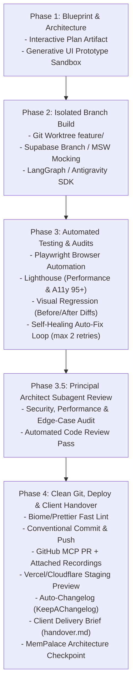

# The Ultimate Agency Pipeline

This skill guides you through building client-ready features with enterprise-grade quality control, security, performance audits, and polished client delivery.

---

## Phase 1 — Blueprint & Architecture

1. **Requirements Ingestion**:
   - Parse client request, identifying user stories, data schemas, and edge cases.
2. **Generative UI Prototype (Sandbox)**:
   - For user-facing features, generate an interactive HTML/Tailwind sandbox prototype in an artifact viewer before writing production code.
   - Allows instant visual feedback and alignment on layout and interactions.
3. **Interactive Implementation Plan**:
   - Generate an Implementation Plan artifact with:
     - Clickable task checklist
     - Mermaid architecture / flow diagram
     - File-by-file changes and diffs
     - Testing & verification criteria
4. **Approval Gate**:
   - **DO NOT write production code until the user approves the plan.**

---

## Phase 2 — Isolated Branch Build

1. **Isolated Worktree / Branch**:
   - Spawn a branch subagent using `invoke_subagent` with `Workspace: "branch"`.
   - Dedicated branch: `feature/<descriptive-slug>`. Main branch remains 100% untouched.
2. **Backend & API Mocking**:
   - **Supabase**: If database schema changes are needed, spin up an isolated Supabase Preview Branch.
   - **Offline / Zero-Cost Mocking**: If third-party APIs (Stripe, Twilio, OpenAI) have rate limits or lack client credentials, create Mock Service Worker (MSW) handlers so development is never blocked.
3. **Code Implementation**:
   - Frontend/3D: Motion Primitives, React Three Fiber, `gltfjsx`, Spline, Tailwind CSS.
   - Agentic AI: `LangGraph` or `Antigravity SDK` patterns with structured outputs.
4. **Rapid Formatting & Linting**:
   - Format with **Biome** (`npx @biomejs/biome check --write .`) or Prettier in milliseconds.

---

## Phase 3 — Automated Visual, Unit & Performance Audits

1. **Automated Browser Walkthrough (`/browser`)**:
   - Invoke `/browser` subagent with headless Chrome sandbox via Playwright MCP.
   - Click through interactive buttons, modals, input forms, and 3D canvases.
   - Inspect and capture browser console logs, uncaught exceptions, and network failures.
   - Capture browser screenshots and video recordings as proof.
2. **Visual Regression Testing**:
   - Compare baseline (before) vs. new (after) screenshots across desktop (1440px) and mobile (375px) viewports to catch unexpected layout shifts.
3. **Lighthouse Core Web Vitals Audit**:
   - Run audit on staging/preview build:
     - Target: **Performance 90+**, **Accessibility (a11y) 95+**, **Best Practices 95+**, **SEO 90+**.
4. **Self-Healing Auto-Fix Loop**:
   - If tests, console logs, or visual checks fail:
     - Read the stack trace or layout defect.
     - Automatically apply code fix in the branch workspace.
     - Re-test (up to 2 autonomous attempts). Only escalate to the user if blocked.

---

## Phase 3.5 — Principal Architect Subagent Review

Before opening any Pull Request, spawn a code-review subagent:
- **Role**: `Principal Security & Performance Architect`
- **Inspects**: The complete `git diff origin/main...HEAD`
- **Verification Checklist**:
  - [ ] No unhandled async errors or missing error boundaries
  - [ ] No SQL injection, XSS vulnerabilities, or secret leaks (`.env`, API tokens)
  - [ ] React hooks dependencies correctly mapped (no memory leaks or infinite re-renders)
  - [ ] Responsive design verified on mobile viewports

---

## Phase 4 — Clean Git, Preview Deploy & Client Handover

1. **Secret Leak Verification**:
   - Automated scan verifying no tokens, credentials, or `.env` files are staged.
2. **Clean Conventional Commits**:
   - Stage and commit with standard prefixes: `feat:`, `fix:`, `perf:`, `chore:`, `docs:`.
3. **GitHub Pull Request via GitHub MCP**:
   - Push branch to remote.
   - Open Pull Request with:
     - Clear business summary of the feature
     - Attached test recordings, screenshots, and Lighthouse score badges
     - Checklist of automated test passes
4. **Staging Preview Deployment**:
   - **Vercel / Cloudflare**: Generate client preview URL.
   - **Expo EAS**: Generate QR preview build for mobile.
5. **Auto-Changelog (KeepAChangelog)**:
   - Update `CHANGELOG.md` under `[Unreleased]` with *Added*, *Changed*, *Fixed*.
6. **Client Delivery Brief (`handover.md`)**:
   - Automatically generate a beautiful client-facing handover document with preview link, feature guide, and summary ready to forward directly to the client.
7. **MemPalace Architecture Checkpoint**:
   - Save high-signal architecture decisions (ADR) into MemPalace so future turns and sessions retain project context verbatim.
