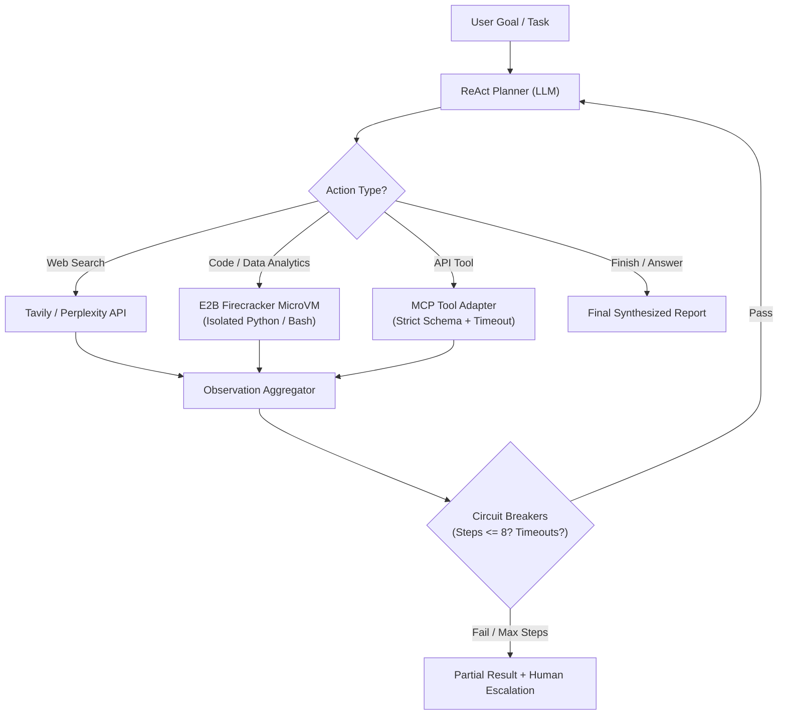

# Archetype Reference: Autonomous Action Agent

Use this reference when building **Autonomous Agents with Tool Use & Sandboxed Code Execution** (deep research, automated web scrapers, data analytics, automated reporting).

---

## 1. Architecture



---

## 2. Complete Python Implementation (ReAct Loop + E2B Sandbox)

```python
import os
import asyncio
from typing import TypedDict, List, Dict, Any, Optional
from pydantic import BaseModel, Field
from e2b_code_interpreter import Sandbox
from langfuse.decorators import observe

MAX_STEPS = 8
TOOL_TIMEOUT = 30.0

class ActionState(TypedDict):
    task: str
    step_history: List[Dict[str, Any]]
    current_step: int
    final_output: Optional[str]
    is_done: bool
    status: str

class ToolCallSchema(BaseModel):
    tool_name: str = Field(description="Name of tool: 'execute_python' | 'web_search' | 'finish'")
    arguments: Dict[str, Any] = Field(description="Arguments for the selected tool")
    thought_process: str = Field(description="Why this tool is chosen")

class AutonomousActionAgent:
    def __init__(self, e2b_api_key: Optional[str] = None):
        self.api_key = e2b_api_key or os.getenv("E2B_API_KEY")

    @observe(name="execute_python_sandbox")
    async def run_sandboxed_code(self, python_code: str) -> str:
        """Executes Python code in an isolated Firecracker microVM."""
        def _exec():
            with Sandbox(api_key=self.api_key) as sandbox:
                execution = sandbox.run_code(python_code)
                output = ""
                if execution.logs.stdout:
                    output += "\n".join(execution.logs.stdout)
                if execution.logs.stderr:
                    output += "\n[ERRORS]: " + "\n".join(execution.logs.stderr)
                if execution.error:
                    output += f"\n[EXCEPTION]: {execution.error.name}: {execution.error.value}"
                return output or "Execution succeeded with no stdout."
        
        # Guard with hard timeout
        return await asyncio.wait_for(asyncio.to_thread(_exec), timeout=TOOL_TIMEOUT)

    @observe(name="web_search")
    async def run_web_search(self, query: str) -> str:
        """Runs search via Tavily/SerpAPI."""
        # Simulated search lookup with timeout
        await asyncio.sleep(0.5)
        return f"Search results for query: {query}"

    @observe(name="run_agent_loop")
    async def run(self, task: str) -> str:
        state: ActionState = {
            "task": task,
            "step_history": [],
            "current_step": 0,
            "final_output": None,
            "is_done": False,
            "status": "running"
        }

        while not state["is_done"] and state["current_step"] < MAX_STEPS:
            state["current_step"] += 1
            step_num = state["current_step"]

            # 1. LLM decides next tool via structured output (Pydantic)
            # tool_call = await llm.with_structured_output(ToolCallSchema).ainvoke(...)
            # Example response:
            if step_num == 1:
                tool_call = ToolCallSchema(
                    tool_name="web_search",
                    arguments={"query": "latest market data 2026"},
                    thought_process="Need up-to-date data before computing stats."
                )
            elif step_num == 2:
                tool_call = ToolCallSchema(
                    tool_name="execute_python",
                    arguments={"python_code": "import numpy as np; print(f'Mean: {np.mean([10, 20, 30])}')"},
                    thought_process="Compute statistical metrics using Python."
                )
            else:
                tool_call = ToolCallSchema(
                    tool_name="finish",
                    arguments={"report": "Final synthesized analysis report."},
                    thought_process="All necessary data gathered and computed."
                )

            # 2. Tool dispatch with error handling
            try:
                if tool_call.tool_name == "web_search":
                    obs = await self.run_web_search(tool_call.arguments["query"])
                elif tool_call.tool_name == "execute_python":
                    obs = await self.run_sandboxed_code(tool_call.arguments["python_code"])
                elif tool_call.tool_name == "finish":
                    state["final_output"] = tool_call.arguments.get("report")
                    state["is_done"] = True
                    break
                else:
                    obs = f"Unknown tool: {tool_call.tool_name}"
            except asyncio.TimeoutError:
                obs = f"Tool '{tool_call.tool_name}' timed out after {TOOL_TIMEOUT} seconds."
            except Exception as e:
                obs = f"Tool failure: {str(e)}"

            state["step_history"].append({
                "step": step_num,
                "tool": tool_call.tool_name,
                "observation": obs
            })

        if not state["is_done"]:
            state["final_output"] = "Circuit breaker triggered: max step limit reached. Returning partial progress."

        return state["final_output"]
```

---

## 3. Production Best Practices Checklist
- [ ] NEVER execute code directly on host machine — use E2B Firecracker sandboxes or isolated Docker containers.
- [ ] Hard step count circuit breaker (`MAX_STEPS = 8`) prevents runaway agent loops and bills.
- [ ] Every tool call wrapped with `asyncio.wait_for` timeout.
- [ ] Tracing records all inputs, thoughts, tool commands, and sandbox outputs for auditing.
