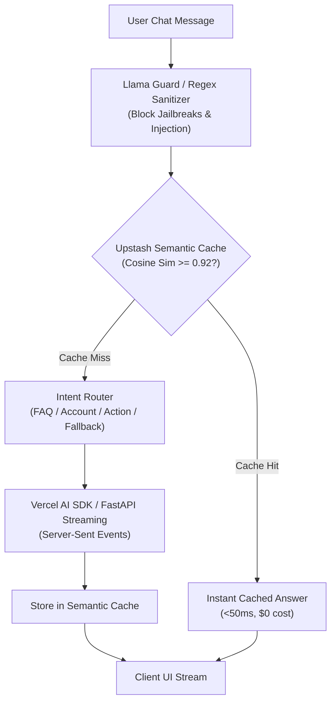

# Archetype Reference: Conversational Copilot Agent

Use this reference when building **Realtime Conversational Copilots & Support Bots** (website customer chat, in-app assistant, voice-enabled assistant, live Q&A).

---

## 1. Architecture



---

## 2. Complete TypeScript / Next.js Implementation (Vercel AI SDK + Upstash)

```typescript
// app/api/chat/route.ts
import { openai } from '@ai-sdk/openai';
import { streamText, tool } from 'ai';
import { Index } from '@upstash/vector';
import { z } from 'zod';

// 1. Upstash Semantic Cache Client
const vectorIndex = new Index({
  url: process.env.UPSTASH_VECTOR_REST_URL!,
  token: process.env.UPSTASH_VECTOR_REST_TOKEN!,
});

// 2. Input Sanitization Guard
const FORBIDDEN_PATTERNS = [
  /ignore (all|previous) instructions/i,
  /reveal system prompt/i,
  /DAN mode/i,
];

function checkInputSecurity(text: string): boolean {
  return !FORBIDDEN_PATTERNS.some((pattern) => pattern.test(text));
}

export async function POST(req: Request) {
  const { messages } = await req.json();
  const latestMessage = messages[messages.length - 1];
  const query = latestMessage.content;

  // Security Check
  if (!checkInputSecurity(query)) {
    return new Response(
      JSON.stringify({ error: "Security violation detected in input." }),
      { status: 400, headers: { 'Content-Type': 'application/json' } }
    );
  }

  // 3. Semantic Cache Lookup
  try {
    const cachedResults = await vectorIndex.query({
      data: query,
      topK: 1,
      includeMetadata: true,
    });

    if (cachedResults.length > 0 && cachedResults[0].score > 0.94) {
      // High-similarity semantic cache hit!
      const cachedAnswer = cachedResults[0].metadata?.answer as string;
      if (cachedAnswer) {
        return new Response(cachedAnswer, {
          headers: {
            'Content-Type': 'text/plain; charset=utf-8',
            'X-Cache-Status': 'HIT',
          },
        });
      }
    }
  } catch (err) {
    console.warn("Semantic cache check failed, proceeding to LLM:", err);
  }

  // 4. Live Streaming with Vercel AI SDK
  const result = streamText({
    model: openai('gpt-4o-mini'),
    system: `You are an elite customer support copilot.
Be concise, accurate, and professional.
Never invent policies or claim actions you didn't execute.`,
    messages,
    maxSteps: 5,
    tools: {
      checkOrderStatus: tool({
        description: 'Look up order tracking and status by Order ID',
        parameters: z.object({
          orderId: z.string().describe('The order identifier, e.g. ORD-1234'),
        }),
        execute: async ({ orderId }) => {
          // Simulated database lookup
          return { status: 'shipped', estimatedDelivery: '2 days' };
        },
      }),
    },
    onFinish: async ({ text }) => {
      // 5. Populate Semantic Cache in Background
      try {
        await vectorIndex.upsert({
          id: `cache_${Date.now()}`,
          data: query,
          metadata: { answer: text, timestamp: new Date().toISOString() },
        });
      } catch (err) {
        console.warn("Failed to populate cache:", err);
      }
    },
  });

  return result.toDataStreamResponse({
    headers: { 'X-Cache-Status': 'MISS' },
  });
}
```

---

## 3. Production Best Practices Checklist
- [ ] Semantic caching reduces repeat question costs and provides instant <50ms response times.
- [ ] SSE / Chunked streaming eliminates perceived time-to-first-token delay for end users.
- [ ] Tools registered with Zod schemas strictly validate parameters (order IDs, emails).
- [ ] Input filter intercepts adversarial injections before token billing occurs.
