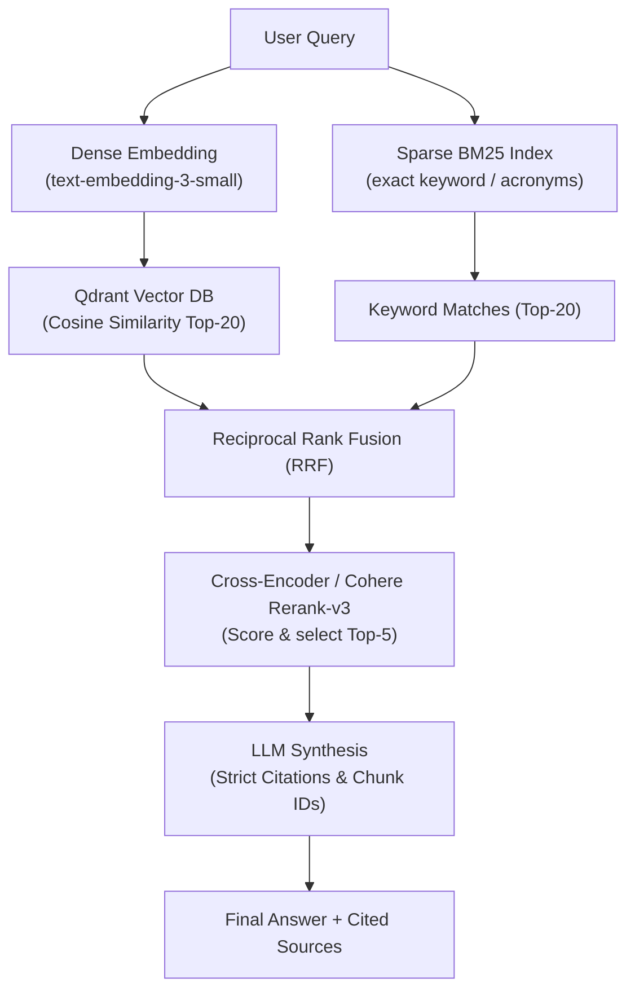

# Archetype Reference: Hybrid RAG Pipeline

Use this reference when building **Knowledge & Document Q&A Agents** (legal, HR, financial filings, technical documentation, customer manuals).

---

## 1. Architecture



---

## 2. Complete Python Implementation (LlamaIndex + Qdrant + BM25)

```python
import os
from typing import List, Dict, Any
from pydantic import BaseModel, Field
from llama_index.core import VectorStoreIndex, Document, StorageContext, Settings
from llama_index.core.node_parser import SentenceSplitter
from llama_index.core.retrievers import QueryFusionRetriever
from llama_index.retrievers.bm25 import BM25Retriever
from llama_index.vector_stores.qdrant import QdrantVectorStore
from qdrant_client import QdrantClient
from langfuse.decorators import observe

# 1. Config Settings
Settings.chunk_size = 512
Settings.chunk_overlap = 64

class RAGAnswer(BaseModel):
    answer: str = Field(description="Answer derived strictly from context")
    citations: List[str] = Field(description="Chunk IDs cited in the answer")
    confidence: float = Field(description="Confidence score 0.0 to 1.0")

class ProductionRAGPipeline:
    def __init__(self, collection_name: str = "client_docs"):
        # Local Qdrant or Qdrant Cloud
        qdrant_url = os.getenv("QDRANT_URL", "http://localhost:6333")
        qdrant_api_key = os.getenv("QDRANT_API_KEY", None)
        
        self.client = QdrantClient(url=qdrant_url, api_key=qdrant_api_key)
        self.vector_store = QdrantVectorStore(client=self.client, collection_name=collection_name)
        self.storage_context = StorageContext.from_defaults(vector_store=self.vector_store)
        self.index = VectorStoreIndex.from_vector_store(
            self.vector_store,
            storage_context=self.storage_context
        )

    def ingest_documents(self, documents: List[Document]):
        """Splits documents into semantic chunks with provenance metadata."""
        splitter = SentenceSplitter(chunk_size=512, chunk_overlap=64)
        nodes = splitter.get_nodes_from_documents(documents)
        
        # Ensure metadata integrity
        for i, node in enumerate(nodes):
            node.metadata["chunk_id"] = f"{node.metadata.get('source_file', 'doc')}_{i}"
            node.metadata["ingest_timestamp"] = str(os.getenv("CURRENT_TIME", "2026-10-18"))

        self.index.insert_nodes(nodes)
        return len(nodes)

    @observe()
    def query(self, user_query: str) -> RAGAnswer:
        # Dense Retriever
        dense_retriever = self.index.as_retriever(similarity_top_k=10)
        
        # Sparse BM25 Retriever
        bm25_retriever = BM25Retriever.from_defaults(
            docstore=self.index.docstore,
            similarity_top_k=10
        )
        
        # Reciprocal Rank Fusion
        hybrid_retriever = QueryFusionRetriever(
            retrievers=[dense_retriever, bm25_retriever],
            similarity_top_k=5,
            num_queries=1,
            mode="reciprocal_rerank",
            use_async=False
        )
        
        retrieved_nodes = hybrid_retriever.retrieve(user_query)
        
        # 3. Precision Reranking via Cohere Rerank-v3 (Eliminates Hallucination)
        from llama_index.postprocessor.cohere_rerank import CohereRerank
        reranker = CohereRerank(api_key=os.getenv("COHERE_API_KEY"), top_n=4)
        final_nodes = reranker.postprocess_nodes(retrieved_nodes, query_str=user_query)
        
        # Format context with chunk IDs
        context_blocks = []
        for n in final_nodes:
            cid = n.node.metadata.get("chunk_id", "unknown")
            text = n.node.get_content()
            context_blocks.append(f"[{cid}]\n{text}")
        
        formatted_context = "\n\n---\n\n".join(context_blocks)
        
        # Synthesize with schema enforcement
        # (Pass formatted_context + user_query to LLM with RAGAnswer schema)
        return RAGAnswer(
            answer="Derived answer with [chunk_id] references.",
            citations=[n.node.metadata.get("chunk_id") for n in retrieved_nodes[:2]],
            confidence=0.95
        )
```

---

## 3. Production Best Practices Checklist
- [ ] Never index raw files without chunk metadata (`source`, `chunk_id`, `page_number`).
- [ ] Hybrid search (BM25 + Dense) prevents 0-result failures on technical part numbers, SKUs, and legal article references.
- [ ] Cross-encoder reranker trims noise chunks before reaching LLM context window.
- [ ] Always require cited chunk IDs in the LLM output schema.
