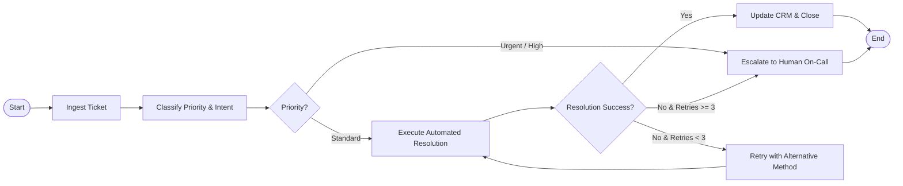

# Archetype Reference: Workflow / State Machine Agent

Use this reference when building **Deterministic Process Automation Agents** (CRM ticket sync, order fulfillment, multi-tier approvals, compliance pipelines).

---

## 1. Architecture



---

## 2. Complete Python Implementation (LangGraph)

```python
import os
from typing import TypedDict, List, Literal, Optional
from pydantic import BaseModel, Field
from langgraph.graph import StateGraph, END
from langgraph.checkpoint.memory import MemorySaver
from langfuse.decorators import observe

# 1. State Definition
class TicketState(TypedDict):
    ticket_id: str
    customer_email: str
    issue_description: str
    priority: Literal["low", "medium", "high", "critical"]
    category: str
    suggested_fix: Optional[str]
    actions_taken: List[str]
    retry_count: int
    is_resolved: bool
    escalated_to_human: bool

# 2. Schema Enforcements
class ClassificationResult(BaseModel):
    priority: Literal["low", "medium", "high", "critical"]
    category: str
    confidence: float

# 3. Graph Node Functions
@observe()
async def classify_ticket_node(state: TicketState) -> dict:
    """Classifies incoming ticket into category and priority."""
    # LLM structured output classification logic here
    # Simulated result:
    return {
        "priority": "medium",
        "category": "billing",
        "actions_taken": state["actions_taken"] + ["classified_ticket"]
    }

@observe()
async def automated_resolution_node(state: TicketState) -> dict:
    """Executes automated database lookup or invoice refund."""
    retries = state["retry_count"] + 1
    # Simulated execution
    resolved = True
    return {
        "retry_count": retries,
        "is_resolved": resolved,
        "actions_taken": state["actions_taken"] + [f"attempt_resolution_run_{retries}"]
    }

@observe()
async def escalate_node(state: TicketState) -> dict:
    """Sends notification to human agent via Slack/Email webhook."""
    return {
        "escalated_to_human": True,
        "actions_taken": state["actions_taken"] + ["escalated_to_human_tier_2"]
    }

@observe()
async def finalize_ticket_node(state: TicketState) -> dict:
    """Updates CRM (e.g. Zendesk, Salesforce) and dispatches customer email."""
    return {
        "actions_taken": state["actions_taken"] + ["crm_updated_closed"]
    }

# 4. Conditional Edge Routers
def route_after_classification(state: TicketState) -> str:
    if state["priority"] == "critical":
        return "escalate"
    return "automate"

def route_after_resolution(state: TicketState) -> str:
    if state["is_resolved"]:
        return "finalize"
    if state["retry_count"] >= 3:
        return "escalate"
    return "automate"

# 5. Build and Compile the Workflow Graph
def build_ticket_workflow():
    workflow = StateGraph(TicketState)
    
    # Add nodes
    workflow.add_node("classify", classify_ticket_node)
    workflow.add_node("automate", automated_resolution_node)
    workflow.add_node("escalate", escalate_node)
    workflow.add_node("finalize", finalize_ticket_node)
    
    # Set entry point
    workflow.set_entry_point("classify")
    
    # Add conditional routes
    workflow.add_conditional_edges(
        "classify",
        route_after_classification,
        {"escalate": "escalate", "automate": "automate"}
    )
    
    workflow.add_conditional_edges(
        "automate",
        route_after_resolution,
        {"finalize": "finalize", "escalate": "escalate", "automate": "automate"}
    )
    
    workflow.add_edge("escalate", END)
    workflow.add_edge("finalize", END)
    
    # Memory Checkpointer enables persistent pause & resume
    checkpointer = MemorySaver()
    return workflow.compile(checkpointer=checkpointer)
```

---

## 3. Production Best Practices Checklist
- [ ] Explicit state schema with TypedDict ensures full type safety across nodes.
- [ ] Explicit retry counters in state prevent infinite loops.
- [ ] Human escalation path is mandatory for mission-critical operations.
- [ ] Checkpointing allows human approval before executing sensitive financial or account mutations.
