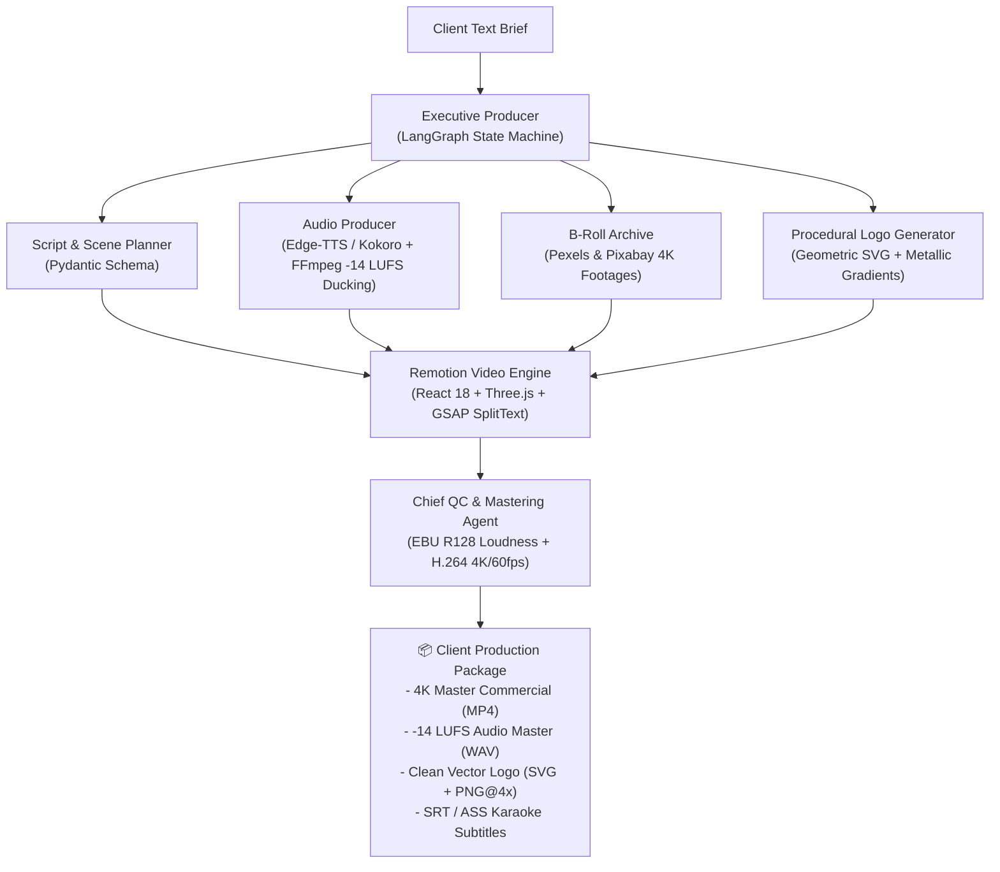

# 🎬 Creative Agent Studio

> **Broadcast-Grade AI Creative Production Pipeline**  
> Produces non-AI-looking 4K commercial videos, 3D device mockups, professional audio mastering, and vector brand kits on command. $0 tool stack.

---

## Architecture Overview



---

## Key Features

1. **Deterministic Motion & Typography**:
   - Built on **Remotion v4** and **GSAP v3**.
   - No rubbery morphing, hallucinatory text, or distorted limbs.
   - Frame-accurate audio/visual alignment at 60 FPS.

2. **3D Hardware Mockups & VFX**:
   - Photorealistic 3D iPhone 16 Pro and MacBook Pro rendered with physical materials via React Three Fiber.
   - Atmospheric floating dust particles and volumetric light leaks.
   - Subtle film grain and chromatic aberration postprocessing.

3. **Studio Sound & Broadcast Mastering**:
   - Microsoft Neural voices (100+ native accents) + local Kokoro-ONNX.
   - Millisecond-accurate word timestamps via Faster-Whisper for karaoke subtitles.
   - Automatic sidechain ducking (-12dB music dip when voiceover speaks).
   - EBU R128 loudness calibration target (-14 LUFS, -1.0 True Peak).

4. **100% Free / $0 Tech Stack**:
   - Zero subscription required. Uses open APIs, MIT libraries, and local neural models.

---

## Quick Start

### 1. Python Environment Setup
```bash
# In the creative-agent-studio root
uv venv
uv pip install -e .
```

### 2. Configure Environment
Copy `.env.example` to `.env` and add your free Pexels / OpenAI keys:
```bash
cp .env.example .env
```

### 3. Run the AI Creative Producer
```bash
python -m agents.orchestrator --brief "Luxury Fintech Debit Card with dark obsidian theme and 3D mockups" --output ./assets/outputs/fintech-ad
```

### 4. Interactive Remotion Video Studio
```bash
cd video
npm install
npm run dev
```

### 5. Render 4K MP4 Commercial
```bash
npm run render:commercial
```
